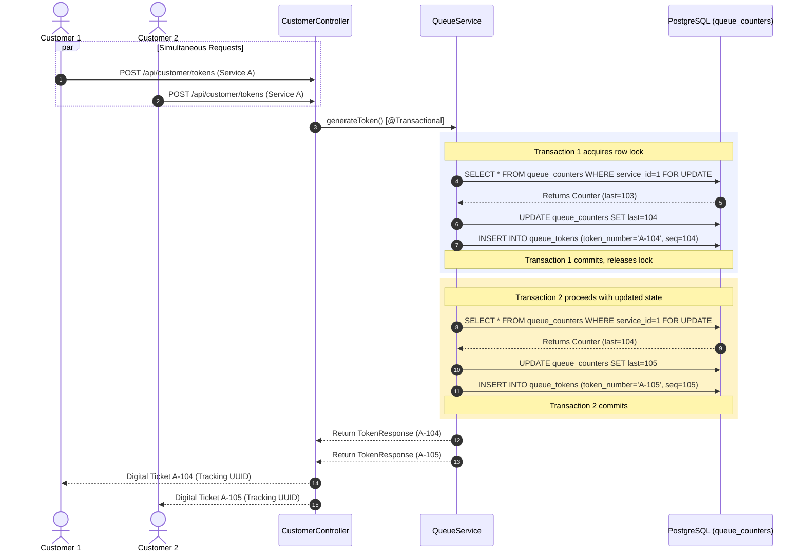

# SMART QUEUE – System Architecture & Technical Design

This document details the software architecture, design principles, concurrency engine, and component interactions of the **SMART QUEUE** platform.

---

## 1. High-Level Architecture Diagram

```mermaid
flowchart TD
    subgraph Clients["Presentation Layer (Client Browsers & TVs)"]
        CP["Customer Mobile Web Portal\n(/take-token, /track/:id)"]
        DB["Waiting Room TV Display Board\n(/display)"]
        SP["Staff Operator Desk\n(/staff)"]
        AP["Admin Executive Console\n(/admin)"]
    end

    subgraph ReverseProxy["Ingress & Web Server"]
        NGINX["Nginx Web Server\n(Port 80 / 3000)"]
    end

    subgraph BackendApp["Application Layer (Spring Boot 3.3 / Java 21)"]
        SEC["Spring Security + JWT Auth Filter"]
        
        subgraph Controllers["REST Controllers"]
            AC["AuthController"]
            CC["CustomerController (Public)"]
            SC["StaffController"]
            ADC["AdminController"]
            SVC["ServiceController"]
            HC["HealthController"]
        end

        subgraph ServiceLayer["Business Logic & Queue Engine"]
            QS["QueueService (Locking & FIFO)"]
            AS["AuthService"]
            SS["StaffService"]
            SMS["ServiceManagementService"]
            ANS["AnalyticsService"]
        end

        subgraph DataAccess["Spring Data JPA Layer"]
            QTR["QueueTokenRepository"]
            QCR["QueueCounterRepository (FOR UPDATE)"]
            SR["ServiceRepository"]
            CR["CustomerRepository"]
            UR["UserRepository"]
        end
    end

    subgraph DatabaseLayer["Data Persistence (PostgreSQL 16)"]
        PG[("PostgreSQL Database\nRow-Level Locking\nACID Transactions")]
    end

    CP -->|HTTP/REST| NGINX
    DB -->|Polling (4s)| NGINX
    SP -->|JWT REST API| NGINX
    AP -->|JWT REST API| NGINX

    NGINX -->|Reverse Proxy /api/*| SEC
    SEC --> Controllers
    Controllers --> ServiceLayer
    ServiceLayer --> DataAccess
    DataAccess -->|HikariCP Connection Pool| PG
```

---

## 2. Core Queue Engine & Concurrency Locking

The platform enforces strict FIFO (First-In, First-Out) queue ordering while remaining completely resilient to simultaneous customer registrations and concurrent staff calls.

### A. Concurrency-Safe Sequential Token Generation



1. **Row-Level Pessimistic Lock (`PESSIMISTIC_WRITE`)**:
   - In Spring Data JPA:
     ```java
     @Lock(LockModeType.PESSIMISTIC_WRITE)
     @Query("SELECT qc FROM QueueCounter qc WHERE qc.service.id = :serviceId AND qc.counterDate = :counterDate")
     Optional<QueueCounter> findByServiceIdAndCounterDateForUpdate(...);
     ```
   - Emits PostgreSQL SQL: `SELECT ... FOR UPDATE`.
   - Forces concurrent transactions on the same service to serialize at the counter row level, ensuring no duplicate sequence numbers can ever be generated.

### B. FIFO Call-Next Mechanism

When a staff member clicks **CALL NEXT**:
1. Checks that the staff member does not already have an active `SERVING` token.
2. Selects the earliest eligible `WAITING` token:
   ```java
   @Lock(LockModeType.PESSIMISTIC_WRITE)
   @Query("SELECT qt FROM QueueToken qt WHERE qt.service.id = :serviceId AND qt.status = 'WAITING' ORDER BY qt.sequenceNumber ASC, qt.createdAt ASC")
   List<QueueToken> findNextWaitingTokensForUpdate(Long serviceId, Pageable pageable);
   ```
3. Updates `status = 'SERVING'`, assigns `servedBy = staffUser`, sets `calledAt = now()`.
4. If two staff members click "CALL NEXT" at the exact same millisecond, the database row-level lock ensures only one worker locks and updates the first token, while the second worker safely acquires the next waiting customer.

---

## 3. Security & Tracking Privacy Model

- **Public Tracking Endpoints**: Customers require zero authentication to generate and view their tokens.
- **Unguessable Tracking UUID**: Instead of exposing predictable primary keys (`/tokens/123`), each ticket is assigned an unguessable 128-bit UUID reference (`tr_9f81c2e4...`).
- **Data Protection**: Public tracking APIs return safe view models (`CustomerTokenTrackingResponse`) concealing sensitive contact information and internal database keys.
- **Administrative Endpoints**: Protected with Spring Security stateless JWT Bearer token authentication and role-based access control (`ROLE_ADMIN`, `ROLE_STAFF`).
- **BCrypt Hashing**: Passwords stored using 10-round salted BCrypt.

---

## 4. Frontend State & Real-Time Polling Strategy

- **Context-Driven Authentication**: `AuthContext.jsx` manages active sessions, role verification, and auto-logout on 401 response.
- **Responsive Adaptive Polling**:
  - Customer Ticket: Polls `/api/customer/tokens/{trackingId}` every 4.5 seconds. When the token transitions from `WAITING` to `SERVING`, plays a Web Audio chime and displays prominent directions.
  - Waiting Room TV: Polls `/api/customer/display-board` every 4 seconds. Detects changes in currently called tokens and chimes for patrons in the room.
  - Staff Working Console: Polls every 4.5 seconds with an instant toggle switch to pause polling.
- **Chart.js Integration**: Real-time reactive doughnut and bar graphs tracking queue volume, service efficiency, and token status.
