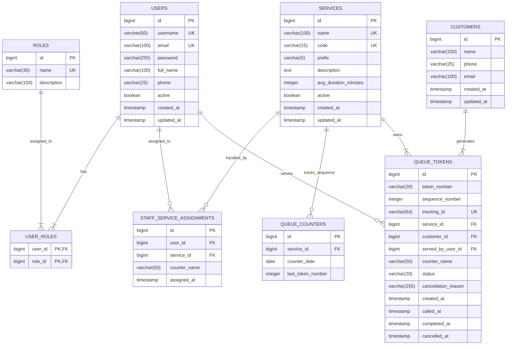

# SMART QUEUE – Entity Relationship (ER) Diagram

The following ER diagram describes the normalized PostgreSQL relational database schema of the **SMART QUEUE** platform, including primary keys, foreign key constraints, indexes, and concurrency-safe locking structures.

## Mermaid ER Diagram

---

## Relational Tables Specification

### 1. `roles`
- **`id`** (`BIGSERIAL`, PK): Unique role identifier.
- **`name`** (`VARCHAR(30)`, UNIQUE, NOT NULL): Role identifier (`ROLE_ADMIN`, `ROLE_STAFF`).
- **`description`** (`VARCHAR(150)`): Role authority scope.

### 2. `users`
- **`id`** (`BIGSERIAL`, PK): Unique user identifier.
- **`username`** (`VARCHAR(60)`, UNIQUE, NOT NULL): Unique login username.
- **`email`** (`VARCHAR(100)`, UNIQUE, NOT NULL): Contact & authentication email.
- **`password`** (`VARCHAR(255)`, NOT NULL): BCrypt one-way cryptographic hash.
- **`full_name`** (`VARCHAR(100)`, NOT NULL): Display name for counters and audit logs.
- **`phone`** (`VARCHAR(25)`): Optional telephone number.
- **`active`** (`BOOLEAN`, NOT NULL, DEFAULT TRUE): Soft-disable switch for accounts.
- **`created_at`**, **`updated_at`** (`TIMESTAMP`, NOT NULL): Audit timestamps.

### 3. `user_roles`
- **`user_id`** (`BIGINT`, FK -> `users.id`, ON DELETE CASCADE).
- **`role_id`** (`BIGINT`, FK -> `roles.id`, ON DELETE CASCADE).
- Composite PK: `(user_id, role_id)`.

### 4. `services`
- **`id`** (`BIGSERIAL`, PK): Unique service entity identifier.
- **`name`** (`VARCHAR(100)`, UNIQUE, NOT NULL): Descriptive desk name (e.g., "Accounts & Billing Desk").
- **`code`** (`VARCHAR(15)`, UNIQUE, NOT NULL): Short system code (e.g., `BILL`).
- **`prefix`** (`VARCHAR(5)`, NOT NULL): Character prefix for tokens (e.g., `B`).
- **`description`** (`TEXT`): Public overview displayed to customers.
- **`avg_duration_minutes`** (`INTEGER`, NOT NULL, DEFAULT 15): Target duration used to calculate dynamic wait time.
- **`active`** (`BOOLEAN`, NOT NULL, DEFAULT TRUE): Controls whether desk accepts new registrations.

### 5. `customers`
- **`id`** (`BIGSERIAL`, PK): Unique customer identifier.
- **`name`** (`VARCHAR(100)`, NOT NULL): Full name of the visiting patron.
- **`phone`** (`VARCHAR(25)`, NOT NULL, INDEXED): Mobile phone for token verification and lookup.
- **`email`** (`VARCHAR(100)`): Optional email for digital receipt.

### 6. `queue_counters` (Concurrency Row Lock Target)
- **`id`** (`BIGSERIAL`, PK): Unique counter sequence tracker.
- **`service_id`** (`BIGINT`, FK -> `services.id`, ON DELETE CASCADE).
- **`counter_date`** (`DATE`, NOT NULL): Current calendar date.
- **`last_token_number`** (`INTEGER`, NOT NULL, DEFAULT 0): Monotonically increasing atomic sequence.
- **Unique Constraint**: `(service_id, counter_date)`.
- **Concurrency Mechanism**: Queries use `SELECT ... FOR UPDATE` (Pessimistic Write Lock) to guarantee sequential gapless allocation during simultaneous customer registrations.

### 7. `queue_tokens`
- **`id`** (`BIGSERIAL`, PK): Unique token identifier.
- **`token_number`** (`VARCHAR(20)`, NOT NULL): Formatted ticket display (e.g., `B-104`).
- **`sequence_number`** (`INTEGER`, NOT NULL): Numeric sequence for strict FIFO ordering.
- **`tracking_id`** (`VARCHAR(64)`, UNIQUE, NOT NULL, INDEXED): Unguessable UUID token reference for public tracking.
- **`service_id`** (`BIGINT`, FK -> `services.id`, NOT NULL).
- **`customer_id`** (`BIGINT`, FK -> `customers.id`, NOT NULL).
- **`served_by_user_id`** (`BIGINT`, FK -> `users.id`, NULLABLE): Staff member currently/previously serving.
- **`counter_name`** (`VARCHAR(50)`): Station designation (e.g., "Counter 1").
- **`status`** (`VARCHAR(20)`, NOT NULL): State machine status (`WAITING`, `SERVING`, `COMPLETED`, `CANCELLED`).
- **`cancellation_reason`** (`VARCHAR(255)`): Audit trail reason if cancelled.
- **`created_at`** (`TIMESTAMP`, NOT NULL): Time token was issued.
- **`calledAt`** (`TIMESTAMP`): Time token status moved to `SERVING`.
- **`completed_at`** (`TIMESTAMP`): Time token status moved to `COMPLETED`.
- **`cancelled_at`** (`TIMESTAMP`): Time token was marked `CANCELLED`.
- **Indexes**:
  - `idx_token_tracking_id` on `(tracking_id)`
  - `idx_token_service_status` on `(service_id, status, sequence_number)`
  - `idx_token_created_at` on `(created_at)`

### 8. `staff_service_assignments`
- **`id`** (`BIGSERIAL`, PK).
- **`user_id`** (`BIGINT`, FK -> `users.id`, ON DELETE CASCADE).
- **`service_id`** (`BIGINT`, FK -> `services.id`, ON DELETE CASCADE).
- **`counter_name`** (`VARCHAR(50)`): Default desk identifier.
- **Unique Constraint**: `(user_id, service_id)`.
